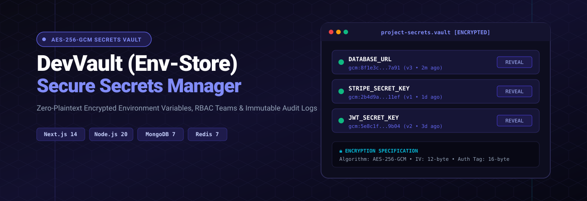

<p align="center">
  
</p>

<h1 align="center">🛡️ DevVault</h1>

<p align="center">
  <strong>Secure Environment Variable Manager for Developers & Teams</strong>
</p>

<p align="center">
  
  
  
  
  
  
</p>

---

## 📌 What is DevVault?

DevVault is a **self-hostable SaaS platform** that lets developers and small teams **securely store, manage, and access** environment variables and secrets — API keys, database credentials, tokens, and more — organized **per project** and **per environment** (Development, Staging, Production).

### The Problem It Solves

| ❌ Before DevVault | ✅ With DevVault |
|---|---|
| Secrets stored in `.env` files locally | Centralized, encrypted secret storage |
| API keys shared via Slack / email | Role-based access with invite system |
| Accidental Git commits of `.env` files | Zero plaintext — AES-256-GCM encryption at rest |
| No idea who accessed what & when | Full audit trail for every action |
| No versioning for secret changes | Automatic version tracking on every update |
| Enterprise tools are complex & expensive | Simple, beautiful, developer-first UX |

---

## ✨ Key Features

### 🔐 Security First
- **AES-256-GCM Encryption** — Military-grade authenticated encryption for all secrets. Values are never stored in plaintext.
- **Two-Factor Authentication (2FA)** — TOTP-based 2FA with QR code setup via authenticator apps (Google Auth, Authy, etc.).
- **JWT Authentication** — Short-lived access tokens (15min) + long-lived refresh tokens (7d). Auto-refresh on expiry.
- **Rate Limiting** — Redis-backed rate limits on login (5/15min), API (100/min), and general routes (60/min).

### 📁 Project & Environment Management
- **Multi-Project Support** — Organize secrets by project (e.g., "My SaaS", "Mobile App", "Marketing Site").
- **Environment Isolation** — Each project gets `Development`, `Staging`, and `Production` environments by default, plus custom ones.
- **Team Collaboration** — Invite members with granular roles: `owner`, `admin`, `developer`, `viewer`.

### 🔑 Secrets Management
- **Encrypted CRUD** — Create, read, update, and delete secrets. Values encrypted before storage, decrypted on reveal.
- **Reveal & Copy** — One-click reveal with eye toggle. Copy to clipboard without revealing in UI.
- **Version Tracking** — Every update increments the version counter. Know when a secret was last changed.
- **Key Formatting** — Auto-uppercase and underscore formatting (e.g., `stripe secret key` → `STRIPE_SECRET_KEY`).

### 📊 Audit Logging
- **Complete Activity Trail** — Every login, secret access, secret change, project creation, token generation is logged.
- **Color-Coded Actions** — Visual distinction between creates (green), updates (yellow), deletes (red), and reads (grey).
- **Paginated History** — Browse through your team's activity with pagination.

### 🔗 API Access
- **API Tokens** — Generate project-scoped API tokens for CI/CD pipelines, deployment scripts, and automation.
- **One-Time Display** — Raw token shown once on creation. Stored as a SHA-256 hash.
- **TTL Expiration** — Tokens auto-expire based on configurable TTL (1–365 days).
- **REST API** — Full REST API with `X-API-Key` header authentication.

### 🎨 Beautiful UI
- **Linear/Vercel-Inspired** — Minimal, clean, developer-first design aesthetic.
- **Dark & Light Mode** — System-aware theme with manual toggle.
- **Framer Motion Animations** — Smooth page transitions, staggered card animations, micro-interactions.
- **Mobile Responsive** — Full responsive design across all screen sizes.

---

## 🏗️ Tech Stack

| Layer | Technology |
|-------|-----------|
| **Frontend** | Next.js 14 (App Router), React 18, Tailwind CSS |
| **Backend** | Node.js 20, Express.js |
| **Database** | MongoDB 7 (Mongoose ODM) |
| **Cache / Rate Limit** | Redis 7 (ioredis) |
| **Authentication** | JWT (jsonwebtoken), bcryptjs |
| **Encryption** | AES-256-GCM (Node.js crypto) |
| **2FA** | TOTP (speakeasy + qrcode) |
| **UI Components** | Radix UI Primitives, Lucide Icons, Framer Motion |
| **DevOps** | Docker, Docker Compose, GitHub Actions CI/CD |

---

## 📂 Project Structure

```
envrecoder/
├── backend/                    # Express.js API Server
│   ├── src/
│   │   ├── config/             # Database, Redis, env config
│   │   │   ├── db.js           # MongoDB connection
│   │   │   ├── redis.js        # Redis client singleton
│   │   │   └── env.js          # Environment variable loader
│   │   ├── models/             # Mongoose schemas
│   │   │   ├── User.js         # User with 2FA fields
│   │   │   ├── Project.js      # Project with members array
│   │   │   ├── Environment.js  # Environment per project
│   │   │   ├── Secret.js       # Encrypted secret storage
│   │   │   ├── AuditLog.js     # Activity audit trail
│   │   │   └── ApiToken.js     # Hashed API tokens
│   │   ├── services/           # Business logic
│   │   │   ├── encryption.js   # AES-256-GCM encrypt/decrypt
│   │   │   ├── twoFactor.js    # TOTP generate/verify
│   │   │   └── tokenService.js # JWT & API token helpers
│   │   ├── middleware/         # Express middleware
│   │   │   ├── auth.js         # JWT + API key auth
│   │   │   ├── rbac.js         # Role-based access control
│   │   │   ├── rateLimiter.js  # Redis rate limiting
│   │   │   ├── auditLogger.js  # Automatic audit logging
│   │   │   ├── validate.js     # Joi request validation
│   │   │   └── errorHandler.js # Global error handler
│   │   ├── controllers/        # Route handlers
│   │   ├── routes/             # Express route definitions
│   │   └── server.js           # App entry point
│   ├── Dockerfile
│   ├── .env.example
│   └── package.json
│
├── frontend/                   # Next.js 14 Application
│   ├── src/
│   │   ├── app/                # App Router pages
│   │   │   ├── page.js         # Landing page
│   │   │   ├── layout.js       # Root layout + providers
│   │   │   ├── login/          # Login with 2FA support
│   │   │   ├── register/       # Registration
│   │   │   └── dashboard/      # Authenticated dashboard
│   │   │       ├── page.js             # Projects grid
│   │   │       ├── projects/[id]/      # Secrets management
│   │   │       ├── audit/              # Audit logs
│   │   │       ├── tokens/             # API tokens
│   │   │       └── settings/           # Profile, 2FA, theme
│   │   ├── components/
│   │   │   ├── ui/             # Shared UI components
│   │   │   │   ├── Button.jsx
│   │   │   │   ├── Input.jsx
│   │   │   │   ├── Card.jsx
│   │   │   │   ├── Dialog.jsx
│   │   │   │   └── Badge.jsx
│   │   │   ├── layout/         # Layout components
│   │   │   │   ├── Sidebar.jsx
│   │   │   │   └── DashboardLayout.jsx
│   │   │   └── ThemeProvider.jsx
│   │   ├── hooks/              # React hooks
│   │   │   ├── useAuth.js      # Auth context + provider
│   │   │   ├── useProjects.js  # Projects CRUD
│   │   │   └── useSecrets.js   # Secrets CRUD + reveal
│   │   └── lib/
│   │       ├── api.js          # Axios client + JWT interceptor
│   │       └── utils.js        # cn() class merger
│   ├── Dockerfile
│   └── package.json
│
├── docker-compose.yml          # Full stack orchestration
├── .github/workflows/ci.yml   # CI/CD pipeline
├── PRD.md                      # Product Requirements
└── DESIGN_TEMPLATE.md          # UI/UX Design Specs
```

---

## 🚀 Getting Started

### Prerequisites

- **Node.js 20+** — [Download](https://nodejs.org/)
- **MongoDB** — Local install or [MongoDB Atlas](https://www.mongodb.com/atlas)
- **Redis** — Local install or [Redis Cloud](https://redis.com/try-free/)

### Option 1: Docker (Recommended)

The fastest way to spin up the entire stack:

```bash
# Clone the repository
git clone https://github.com/your-username/devvault.git
cd devvault

# Start everything
docker-compose up --build
```

| Service | URL |
|---------|-----|
| Frontend | http://localhost:3000 |
| Backend API | http://localhost:5000/api |
| MongoDB | localhost:27017 |
| Redis | localhost:6379 |

### Option 2: Manual Setup

**1. Backend**

```bash
cd backend
cp .env.example .env    # Edit with your values
npm install
npm run dev             # Starts on http://localhost:5000
```

**2. Frontend**

```bash
cd frontend
npm install
npm run dev             # Starts on http://localhost:3000
```

### Environment Variables

Create `backend/.env` from `.env.example`:

```env
PORT=5000
NODE_ENV=development
MONGODB_URI=mongodb://localhost:27017/devvault
REDIS_URL=redis://localhost:6379

# Auth (generate strong random strings for production)
JWT_ACCESS_SECRET=your-access-secret-min-32-chars
JWT_REFRESH_SECRET=your-refresh-secret-min-32-chars
JWT_ACCESS_EXPIRY=15m
JWT_REFRESH_EXPIRY=7d

# Encryption (64-char hex = 256-bit key)
ENCRYPTION_MASTER_KEY=your-64-char-hex-key-here

# App
FRONTEND_URL=http://localhost:3000
APP_NAME=DevVault
```

> ⚠️ **Generate a real encryption key for production:**
> ```bash
> node -e "console.log(require('crypto').randomBytes(32).toString('hex'))"
> ```

---

## 🔌 API Reference

All endpoints are prefixed with `/api`. Authenticated routes require a `Bearer` token or `X-API-Key` header.

### Authentication

| Method | Endpoint | Description | Auth |
|--------|----------|-------------|------|
| `POST` | `/auth/register` | Create account | ❌ |
| `POST` | `/auth/login` | Login (returns JWT or 2FA challenge) | ❌ |
| `POST` | `/auth/refresh` | Refresh access token | ❌ |
| `GET` | `/auth/me` | Get current user profile | ✅ |
| `POST` | `/auth/2fa/setup` | Generate 2FA QR code | ✅ |
| `POST` | `/auth/2fa/verify` | Enable 2FA with TOTP code | ✅ |
| `POST` | `/auth/2fa/disable` | Disable 2FA | ✅ |

### Projects

| Method | Endpoint | Description | Auth |
|--------|----------|-------------|------|
| `GET` | `/projects` | List all projects | ✅ |
| `POST` | `/projects` | Create project | ✅ |
| `GET` | `/projects/:id` | Get project details | ✅ |
| `DELETE` | `/projects/:id` | Delete project (cascade) | ✅ Owner |
| `POST` | `/projects/:id/members` | Invite member | ✅ Admin+ |
| `DELETE` | `/projects/:id/members/:userId` | Remove member | ✅ Admin+ |

### Environments

| Method | Endpoint | Description | Auth |
|--------|----------|-------------|------|
| `GET` | `/projects/:id/environments` | List environments | ✅ |
| `POST` | `/projects/:id/environments` | Create environment | ✅ Admin+ |
| `DELETE` | `/projects/:id/environments/:envId` | Delete environment | ✅ Admin+ |

### Secrets

| Method | Endpoint | Description | Auth |
|--------|----------|-------------|------|
| `GET` | `…/environments/:envId/secrets` | List secrets (masked) | ✅ |
| `POST` | `…/environments/:envId/secrets` | Create secret | ✅ Dev+ |
| `PUT` | `…/secrets/:secretId` | Update secret | ✅ Dev+ |
| `DELETE` | `…/secrets/:secretId` | Delete secret | ✅ Dev+ |
| `GET` | `…/secrets/:secretId/reveal` | Reveal decrypted value | ✅ Dev+ |

### Audit Logs

| Method | Endpoint | Description | Auth |
|--------|----------|-------------|------|
| `GET` | `/audit` | List audit logs (paginated) | ✅ |

### API Tokens

| Method | Endpoint | Description | Auth |
|--------|----------|-------------|------|
| `GET` | `/tokens` | List tokens | ✅ |
| `POST` | `/tokens` | Create token (shown once) | ✅ |
| `DELETE` | `/tokens/:id` | Revoke token | ✅ |

---

## 🔒 Security Architecture

```
┌──────────────────────────────────────────────────────┐
│                     CLIENT                           │
│  Browser / CI Pipeline / CLI                         │
└──────────┬───────────────────────────────┬───────────┘
           │ JWT Bearer Token              │ X-API-Key
           ▼                               ▼
┌──────────────────────────────────────────────────────┐
│                  EXPRESS SERVER                       │
│                                                      │
│  ┌─────────────┐  ┌──────────┐  ┌────────────────┐  │
│  │ Rate Limiter│→ │  Auth    │→ │  RBAC          │  │
│  │   (Redis)   │  │ Middleware│  │  Middleware     │  │
│  └─────────────┘  └──────────┘  └────────────────┘  │
│                                                      │
│  ┌─────────────────────────────────────────────────┐ │
│  │              CONTROLLERS                        │ │
│  │  auth · projects · environments · secrets       │ │
│  └─────────────┬───────────────────────────────────┘ │
│                │                                     │
│  ┌─────────────▼───────────────────────────────────┐ │
│  │           SERVICES                              │ │
│  │  AES-256-GCM Encryption  ·  TOTP 2FA  ·  JWT   │ │
│  └─────────────┬───────────────────────────────────┘ │
│                │                                     │
│  ┌─────────────▼───────┐  ┌────────────────────────┐│
│  │     MongoDB         │  │       Redis            ││
│  │  Users · Projects   │  │  Rate limits · Cache   ││
│  │  Secrets · Logs     │  │  Token blacklist       ││
│  └─────────────────────┘  └────────────────────────┘│
└──────────────────────────────────────────────────────┘
```

| Layer | Protection |
|-------|-----------|
| **Transport** | HTTPS (TLS) in production |
| **Authentication** | JWT with 15min expiry + refresh rotation |
| **Authorization** | Per-project RBAC (owner/admin/dev/viewer) |
| **Encryption** | AES-256-GCM (authenticated encryption with IV + auth tag) |
| **Passwords** | bcrypt with salt rounds |
| **Rate Limiting** | Redis sliding window (login: 5/15min, API: 100/min) |
| **Audit** | Every sensitive action logged with user, IP, timestamp |
| **Tokens** | API tokens stored as SHA-256 hashes, raw shown once |

---

## 🐳 Docker

### Build Individual Images

```bash
# Backend
docker build -t devvault-backend ./backend

# Frontend
docker build -t devvault-frontend ./frontend
```

### Docker Compose Services

| Service | Image | Port |
|---------|-------|------|
| `backend` | Custom (Node 20 Alpine) | 5000 |
| `frontend` | Custom (Next.js Standalone) | 3000 |
| `mongo` | mongo:7 | 27017 |
| `redis` | redis:7-alpine | 6379 |

Both app containers run as **non-root users** for security.

---

## 🔄 CI/CD Pipeline

The GitHub Actions workflow (`.github/workflows/ci.yml`) runs on every push/PR to `main`:

```
lint-backend ──→ test-backend ──┐
                                ├──→ docker-build (main only)
lint-frontend ─→ build-frontend ┘
```

- **Lint** — ESLint on both backend and frontend
- **Test** — Backend tests with MongoDB + Redis service containers
- **Build** — Next.js production build
- **Docker** — Image builds on main branch pushes

---

## 🗂️ RBAC Roles

| Role | Create Secrets | Read Secrets | Update Secrets | Delete Secrets | Manage Members | Delete Project |
|------|:-:|:-:|:-:|:-:|:-:|:-:|
| **owner** | ✅ | ✅ | ✅ | ✅ | ✅ | ✅ |
| **admin** | ✅ | ✅ | ✅ | ✅ | ✅ | ❌ |
| **developer** | ✅ | ✅ | ✅ | ✅ | ❌ | ❌ |
| **viewer** | ❌ | ✅ | ❌ | ❌ | ❌ | ❌ |

---

## 📜 Scripts

### Backend (`/backend`)

```bash
npm run dev       # Start with nodemon (hot reload)
npm start         # Production start
npm run lint      # Run ESLint
npm test          # Run Jest tests
```

### Frontend (`/frontend`)

```bash
npm run dev       # Dev server on :3000
npm run build     # Production build
npm start         # Serve production build
npm run lint      # Run ESLint
```

---

## 📄 License

This project is licensed under the **MIT License**.

---

<p align="center">
  Built with 🔐 by <strong>DevVault</strong>
</p>
